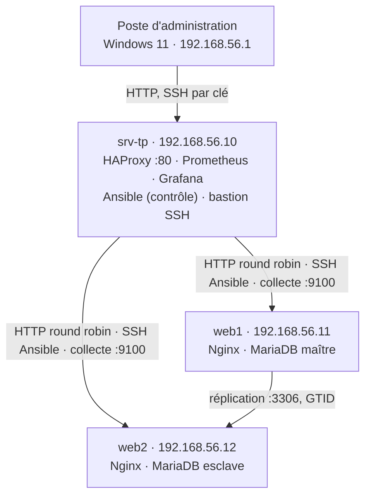
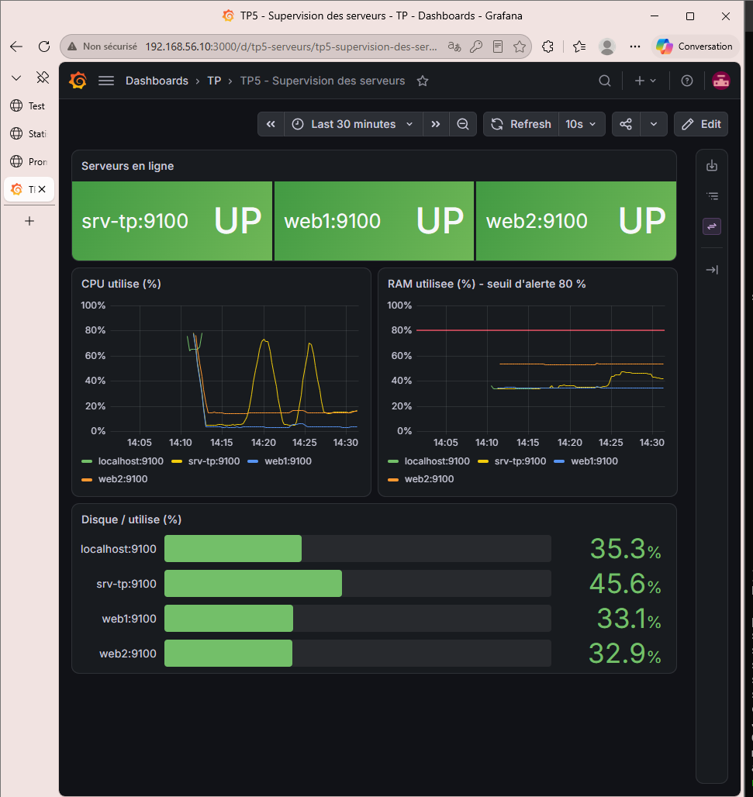
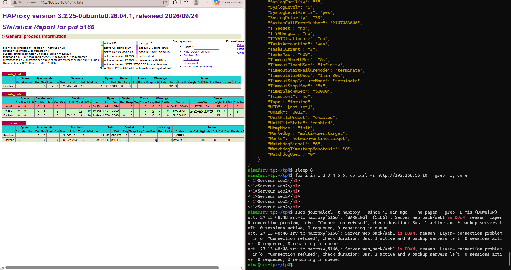

# Administration avancée de serveurs Linux : infrastructure web sécurisée et automatisée

Laboratoire réalisé dans le cadre d'une formation en administration systèmes : trois serveurs Ubuntu Server 26.04 LTS
hébergent un site web en haute disponibilité, sécurisé, supervisé, et **entièrement déployé par Ansible**
(`ansible-playbook site.yml`, 8 rôles, idempotent).

## Architecture



Réseau privé VirtualBox 192.168.56.0/24 ; chaque VM a aussi une carte NAT pour l'accès à internet.

## Technologies

| Domaine | Outils |
| --- | --- |
| Système | Ubuntu Server 26.04 LTS, LVM, netplan, ACL, cron |
| Sécurité | OpenSSH (clé uniquement, liste blanche), fail2ban, nftables, auditd, ansible-vault |
| Services | Nginx, MariaDB (réplication maître/esclave GTID), HAProxy |
| Automatisation | Bash, Ansible (rôles, templates Jinja2, handlers, host_vars) |
| Supervision | Prometheus, node_exporter, Grafana (provisionné), règles d'alerte |

## Contenu du dépôt

| Dossier | Contenu |
| --- | --- |
| [`TP1`](TP1) | ACL sur `/srv/data`, script de sauvegarde et tâche cron |
| [`TP2`](TP2) | durcissement SSH, fail2ban, pare-feu nftables, règles et journaux auditd |
| [`TP3`](TP3) | HAProxy, réplication MariaDB, rapport de tests de panne |
| [`TP4`](TP4) | script Bash, playbooks, inventaire, rôle Ansible `firewall` |
| [`TP5`](TP5) | Prometheus, règle d'alerte RAM, provisionnement et tableau de bord Grafana |
| [`projet_final`](projet_final) | projet Ansible complet : `site.yml`, 8 rôles, inventaire, variables, [README d'exploitation](projet_final/README.md) |
| [`captures`](captures) | captures d'écran des tests |

## Résultats

- **Déploiement en une commande**, sans erreur ; une 2e exécution donne `changed=0` sur les 3 serveurs (idempotence).
- **Haute disponibilité web** : panne d'un serveur détectée par HAProxy en 4 s, le site reste en ligne.
- **Réplication** : l'esclave rattrape son retard après une panne et reste lisible si le maître tombe.
- **Sécurité** : SSH par clé uniquement, root interdit, liste blanche ; serveurs web joignables en HTTP
  uniquement via le load balancer ; ports d'administration réservés au poste admin ; secrets chiffrés par ansible-vault.
- **Supervision** : 4 alertes (serveur injoignable, RAM > 80 %, CPU > 90 %, disque > 85 %) ; l'alerte RAM a été testée
  et déclenchée (96,5 % sur web2).





## Déployer le projet final

Depuis le nœud de contrôle (Ansible installé, clé SSH déployée sur les serveurs web) :

```bash
cd projet_final
cp group_vars/all/vault.yml.example group_vars/all/vault.yml   # puis y mettre les mots de passe
ansible-vault encrypt group_vars/all/vault.yml
ansible-playbook site.yml --syntax-check
ansible-playbook site.yml -K --ask-vault-pass
```

## Problèmes résolus (extraits)

| Problème | Cause | Solution |
| --- | --- | --- |
| Ansible : `Timeout waiting for privilege escalation prompt` | Ubuntu 26.04 utilise sudo-rs, dont l'invite n'est pas reconnue | `ansible_become_exe=sudo.ws` |
| fail2ban ne détectait aucune attaque SSH | les refus sont journalisés par `sshd-session`, pas par `sshd` | `journalmatch = _SYSTEMD_UNIT=ssh.service` |
| Mots de passe SSH toujours acceptés | `50-cloud-init.conf`, lu en premier, réactivait `PasswordAuthentication` | directives placées avant l'`Include` (sshd garde la première valeur lue) |
| `Host key verification failed` dans Ansible | empreintes enregistrées par nom, connexion par IP | empreintes vérifiées puis enregistrées pour chaque IP |

## Auteur

Nihad, formation Administration avancée de serveurs Linux, octobre 2026.
